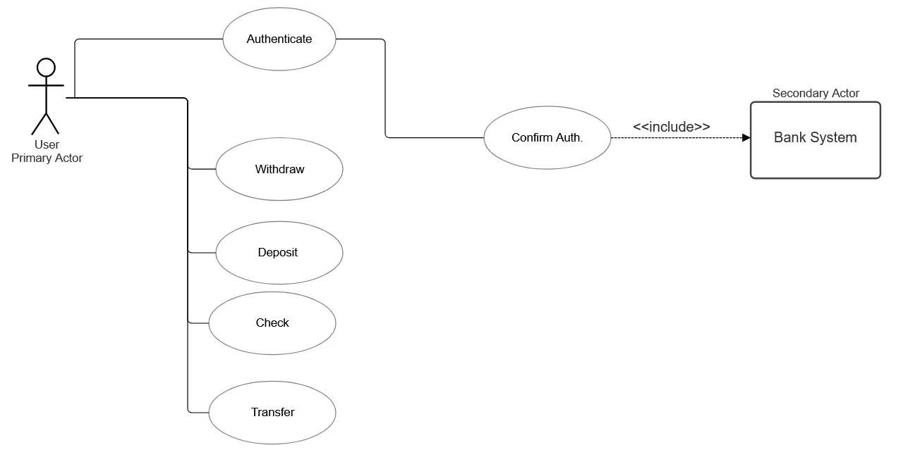

## 1. Project Objectives

- Create a secure and fast ATM system, that allows for users to access their accounts and manipulate funds:
	- Make a fluid and easy to use UI with accessibility features, guiding the user through the necessary inputs for operations and authorisation. 
	- Ensure that the interaction between the front and backends is secure.
	- Let the backend handle the transaction logic.

## 2. Scope of work

The user base are individuals with access to bank accounts or to cardless operations

## 3. Functional Requirements:

- Software:
	- ***Backend***; Authentication and Authorisation, services (fund manipulation...), data integrity and protection, handling the user input, even when wrong, and giving appropriate answer, applying security measures to stop the most common cyberattacks.
	- ***Frontend***; easy to use, displays the messages sent by the backend, multiple language options, clear messages to guide the user, sanitation of input, clear error messages for users to understand what they did wrong.
	- ***Database***; ACID compliant, query optimisation, user privilege levels

- Human level:
	- Clients (user): inputting credentials to gain access, sending data to the backend through the frontend that will be handled by it and answered accordingly (checking balance, deposit, withdrawal, transfer...) which then the frontend will display

