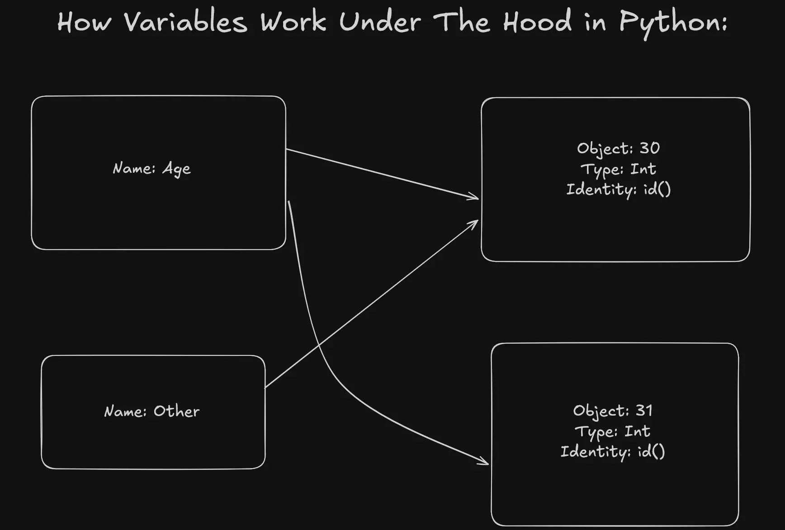

## General Definitions and Examples

### Automatic Refrence Counting
Automatic Reference Counting implements automatic memory management, freeing the programmer from the need to explicitly insert retains and releases. It does not provide a cycle collector; users must explicitly manage the lifetime of their objects, breaking cycles manually or with weak or unsafe references

### Garbage Collector
A Garbage Collector removes the need for explicitly managing the lifetime of objects, breaking cycles manually or with weak or unsafe references, by handling these tasks on its own

### Primitive types in python are immutable, refrence types are mutable:

Primitive types include: `int, bool, str...`\
Refrence types include: `list, dict, set...`

_**Example:**_

```python
a = [6, 7]
b = a
b.append(40)
print(a) 
print(b) # Both will be [6, 7, 40]
```

### How variables work under the hood:
Imagine a code snippet like the following:
```python
age = 30
other = age
other = 31
```
This how Python handles it:
