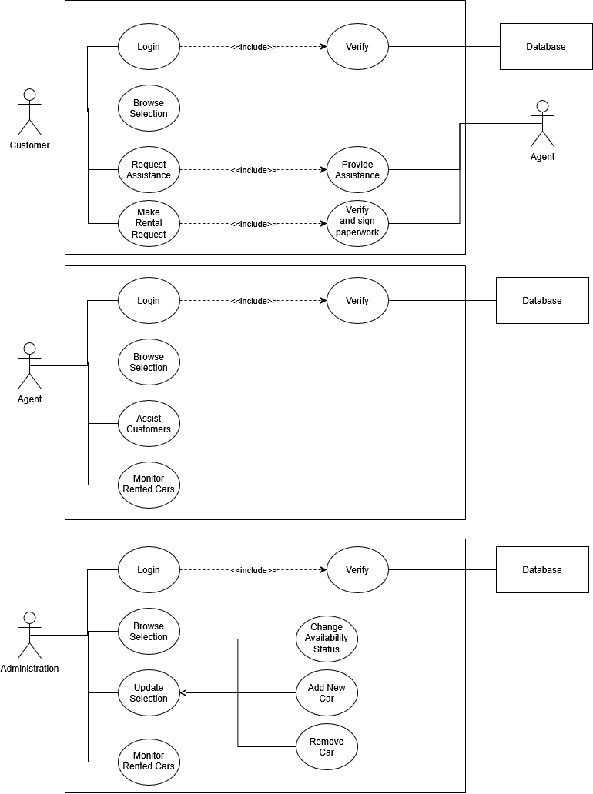

# Project Objectives:

Create a system that facilitates the process of renting a car.
This system should allow for smooth interaction between customers, agents, and the administration

# Scope of work: 

This system's users will be customers, agents, and administration members

# Problematic:

How would a car rental system function? And what will the interactions between different types of users look like?

# Functional Requirements:

The customers will be able to browse the selection of cars, make rental requests and ask for assistance.
Agents will be capable of checking the car selection, provide customers with assistance and monitor the already rented cars.
The administration should be capable of browsing the current selection, updating the status of cars: rented or not, remove a car from the selection as well as add new ones.

# Key Roles:
- Customer: Primary Actor
- Agent: Primary and Secondary Actor
- Administration: Primary Actor
- Database: Secondary Actor

