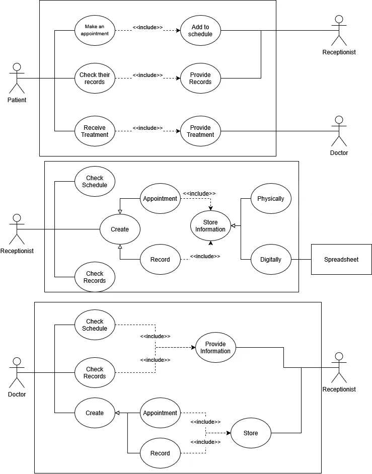

# Project Objectives:

Create a system that allows for the management of doctor appointments, handling the interaction between doctors, receptionist, and patients.

# Scope of work:

This system will be utilized by doctors, receptionists, and patients.

## Problematic:

How can we create a system that handles doctor appointments and patient documents?

# Functional requirements:

This system will allow for receptionists to keep track of patients' schedules and records, and check up with the doctors to verify patient records.
As for patients, they'll be able to schedule appointments with their doctors through receptionist, and receive the necessary treatments from their doctor.
Doctors will be able to check with the receptionists for patient records, and give treatment to patients.

## Key roles:
- Doctors: Primary Actor.
- Patients: Primary Actor.
- Receptionist: Primary & Secondary Actor.

