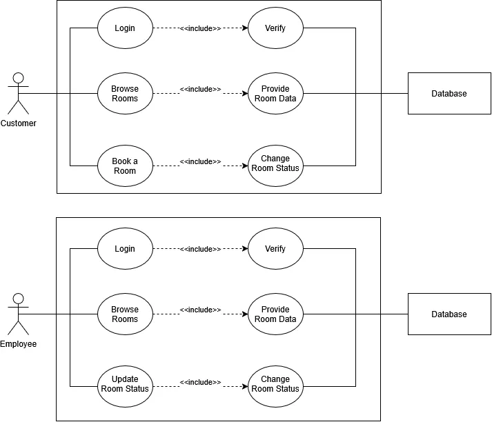

# Project Objective:

Create a system that will help customers as well as employees to keep track of hotel reservations.

# Scope of Work:

This system will be used by customers looking to make reservations at a hotel. Employees will use it to keep track of said reservations.

## Problematic:

How can we keep track of free rooms to allow for an easier reservation process?

# Functional Requirements:

Employees will use the system to keep track of reservations: check which rooms are free, and during which time period, update room status...
Customers will use this system to make their reservations and browse the rooms provided.

## Key roles:
- Employees: Primary Actor
- Customers: Primary Actor
- Database: Secondary Actor, verifies login info and stores and validates data concerning room availability.

