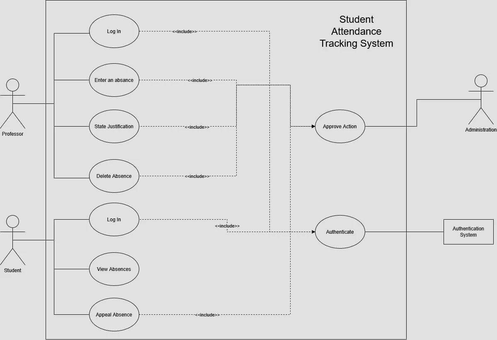

# Project Objective:
Create a student attendance tracking system.
The absences tracked should be approved by the administration, they should be open to deletion, and to modification (justified, unjustified)

Students should be able to access the attendance sheet related to them and be able to view their attendance and appeal it

The administration is responsible for approving actions done by either professors or students

# Scope of work:
This system will be used by teachers, students and administration to track attendance.

# Functional requirements:
The system will keep track of student's attendance, which will be input by professors and then approved by the administration
The system should take login data to determine wether the user is a student or a professor, then delegate the authentication to the system purpose made for it.

Professors having the ability to manipulate the attendance data.
Students being able to view and appeal their own attendance.
Administration being responsible for the verification of the actions done by both actors.

