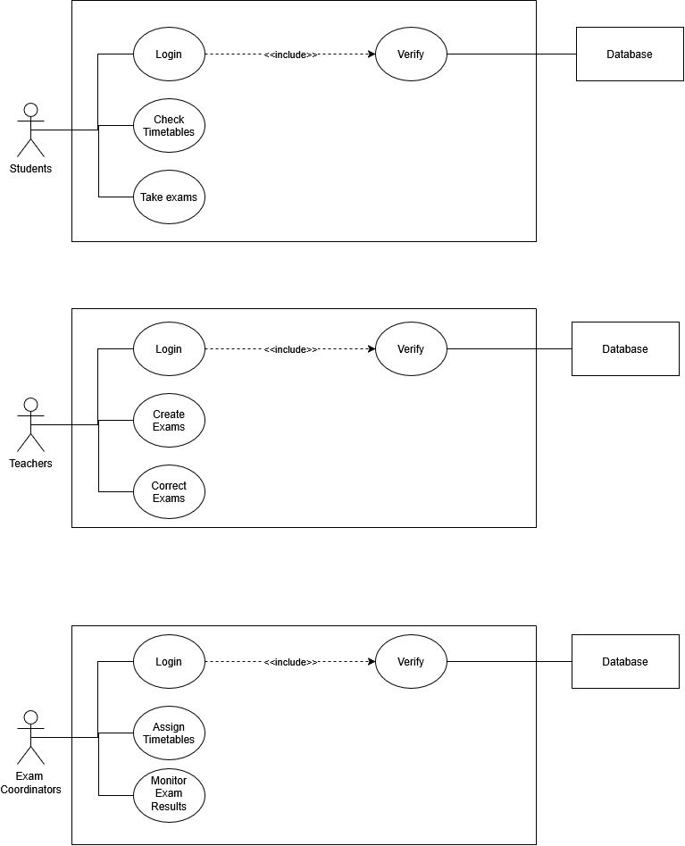

# Project Objectives:

Create a system that allows for robust university exam organization. Giving students an easy platform to understand their exam timetables and requirements, and for teachers and exam coordinators to work together and manage the exams flawlessly.

# Scope of work:

This system will be primarily used by students, teachers and exam coordinators.

# Problematic:

How will a system for exam management allow students, teachers, and exam coordinators to interact with it?

# Functional Requirements:

Students will browse the exam timetables, and be able to take exams using this system.
Teachers will be able to make exams and correct the answered copies.
The administration will be able to monitor the results of exams and assign exam timetables.

# Key roles:
- Student: Primary Actor
- Teachers: Primary Actor
- Exam Coordinators: Primary Actor
- Database: Secondary Actor

