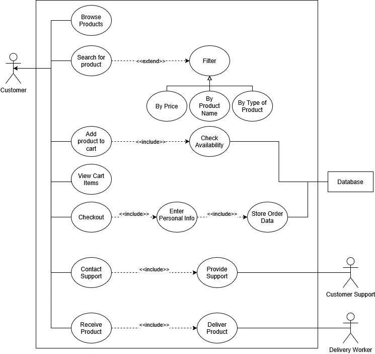

# Project Objective:

This system will allow for customers to browse and purchase products online.

# Scope of Work:

Customers looking to buy products online.

## Problematic:

What does an ecom website need to allow for a good user experience when eshopping?

# Functional Requirements:

The customer should be allowed to browse all the products that the e-shop has, add items to their virtual cart if they're in stock, have access to multiple payment methods, as well as being able to enter discount coupons and redeem codes.

## Key Roles:
- Customers: Primary Actor.
- Database: Secondary Actor, it updates the stock on current products.
- Customer Support: Secondary Actor, it provides assistance for customers in case they're having issues with their purchase.

