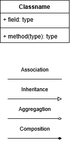

# Class Diagram
This diagram describes the different types of objects in a system and the static relations between them, using associations to relate between them.
# Component Diagram
This diagram is used to illustrate components of a larger software system, and the dependencies between them.
# Deployment Diagram
This diagram helps model the physical aspect of an object-oriented software system (ie client-server...).
# Object Diagram
It is an instance of the Class diagram, unlike the latter, it isn't static and shows off the class diagram at a specific time, its main usage is to show off an example of an instance of a Class diagram
# Package Diagram
This diagram shows packages and the dependencies between them, it allows for easy representation of layered applications.

###### *This is annoying*

# Use case Diagram
## Definition:
- A use case diagram is a type of UML diagram that describes the functionality of a system from the perspective of the users
- It shows the interaction between external entities and the system
## Aim:
- The main goal of a use case diagram is to model the interaction between the system and its users, capturing what the system is supposed to to do.
- This helps in defining the system's boundaries and clarifying the system's requirements from the user's point of view
## Key Elements:
- **Actors**:
  - *Definition*:
    - Actors are external entities (either human users or other systems) that interact with the system.
  - *Types*:
    - **Primary Actor:** Directly interacts with the system to achieve a goal. This is often with the system.
    - **Secondary Actor:** Assists the primary actor or plays a supportive role in the use case.
- **Use Cases:**
  - *Definition:*
    - Use cases represent the functional requirements of the system. Each use case describes a specific action or functionality that the system can perform in response to an interaction with an actor.
  - *Purpose:*
    - They specify the system's functionality in a way that is understandable to users, developers and stakeholders.

## Relationships:
- **Association:**
  - *Definition:*
    - Associations represent the interaction between an actor and a use case, showing which actors participate in which use cases.
  - *Notation:*
    - A solid line connects the actor to the use case to represent the association.
- **Inclusion:**
  - *Definition:*
    - Inclusion is used to indicate that one use case includes the functionality of another use case. This allows for reusing common functionality across multiple use cases.
  - *Notation:*
    - A dashed arrow labeled `<<include>>` points from the primary use case to the included use case.
- **Extension:**
  - *Definition:*
    - Extension allows you to show optional or conditional functionality that extends the behavior of a use case. This is used when the base use case provides the core behavior, but additional behavior can occur under certain conditions.
  - *Notation:*
    - A dashed arrow labeled `<<extend>>` points from the extending use case to the base use case.
- **Inheritance:**
  - *Definition:*
    - Inheritance represents a generalization relationship between actors or use cases, where a specified element inherits the characteristics and behavior of a more general element.
  - *Notation:* 
    - A solid line with a hollow triangle as an arrowhead from the specialized actor or use case to the generalized actor or use case.

# Class Diagram:
## Definition:
It's a diagram that describe the static structure of a system by showing its classes, attributes, methods, and the relationships between the objects in the system. It's a blueprint of how instances of classes (objects) are created and interact with each other.
## Aim:
They are fundamental for Object-Oriented design because they help map out the structure and the behavior of a system before the implementation.
They allow developers to visualize and plan how different objects will relate and interact within a software system.
## Key elements:
- **Classes:**
  - They are the building blocks of object-oriented programming. A class represents a template or a blueprint from which objects (instances) are created.
  - **Structure:**
    - *Name:* The name of the class, it's typically written at the top of the class diagram box.
    - *Attributes:* Variables or data structures that describe the state of an object.
      - Attributes define the properties or data members of a class.
      - Each attribute is defined with its data type and visibility (public, private, protected)
      - Visibility is often indicated in diagrams by symbols:
        - ` + ` : public, accessible from outside the class.
        - ` - ` : private, only accessible from within the class.
        - ` # ` : protected, accessible from within the class and its subclasses.

    - *Methods:* Functions that define the behavior or actions that the object can perform.
      - They represent the operations or functions the class can perform.
      - They have visibility symbols and return types.

    - In Object-Oriented Programming, *accessors* **(getters)** and *mutators* **(setters)** are methods used to read or modify the attributes of an object. They are closely related to encapsulation.
  - **Relationships:** \
  Relationships are essential to understand how classes interact with each other in a system.
      - **Association:** It represents a general relationships between two classes where objects of one class are linked to objects of another.
        - *Directionality:* Association can be unidirectional (one class knows about the other) or bidirectional (both classes know about each other).
        - *Multiplicity:* Specifies how many instances of a class are associated with instances of another class (one-to-one, one-to-many, many-yo-many)
      - **Inheritance:** It's an 'is-a' relationship between two classes, where a subclass inherits attributes and methods from a parent class.
      - **Aggregation:** It is a "whole part" relationship where a class is a composed of one or more classes (parts). The part **can** exist independently of the whole.
      - **Composition:** It is a "whole part" relationship where a class is a composed of one or more classes (parts). The part **can't** exist independently of the whole.
  
 